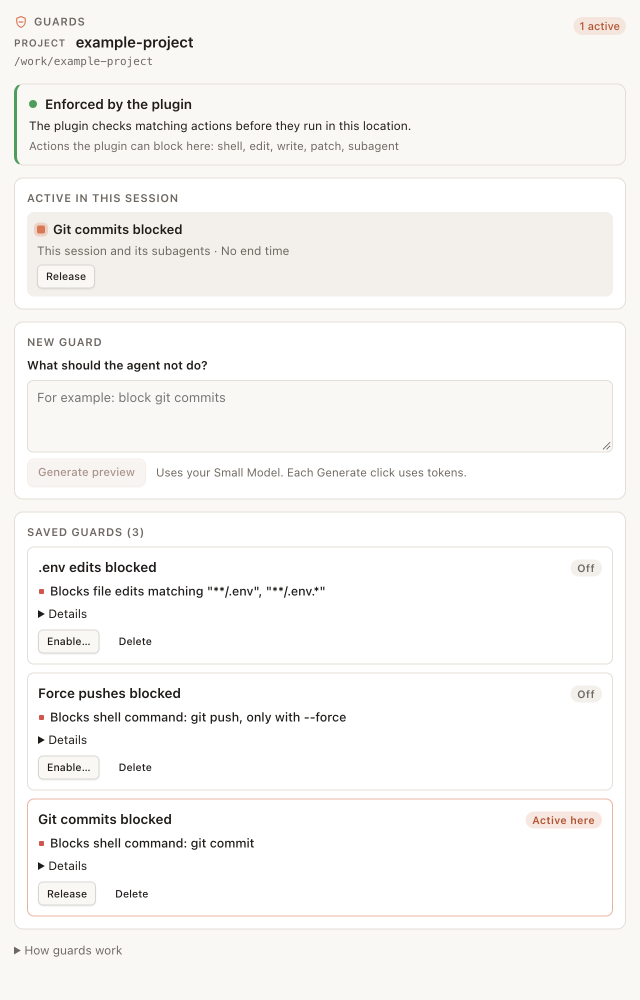

# OpenChamber guard extension

OpenChamber Guard Extension lets you define guards that block actions you do not want the agent to run, such as Git
commits or edits to `.env` files. You describe the guard in plain language, and a Small Model turns it into a
code-enforced rule.

A **guard** is a saved list of rules. You can enable a guard for a session or for a single request; the panel labels
those scopes **This session** and **This request**.

The extension has three parts: guard controls in an OpenChamber panel, an authenticated local service that saves guards
and records where they are enabled, and a bundled OpenCode plugin that denies matching actions before OpenCode runs
them.



*The running panel shows the enforcement status and one active guard.*

## Install and verify

The package declares OpenChamber `>=2.7.0` in its [manifest](package.json).

1. In OpenChamber, add the package root under **Settings -> Extensions**.
2. Approve access to the Small Model, sessions, local service, and bundled OpenCode plugin. The service runs with your
   full user privileges, outside the panel sandbox.
3. Open the Guards panel in a session. OpenChamber installs the bundled plugin on its managed local OpenCode server.
4. Wait for **Enforced by the plugin** before relying on a guard.

That status comes from a fresh plugin runtime report for the current location. It confirms the plugin has registered its
enforcement check and can use the saved guard state there. A missing, stale, or unreadable report does not confirm
enforcement; existing rules may still be active.

## Use the panel

1. Open **Guards** in the session where the guard should apply.
2. In **New guard**, enter a plain-text guard request such as “block Git commits” and select **Generate preview**. Each
   click sends the request to your Small Model and uses tokens.
3. Review the proposed rules, description, and message the agent will see. The request and description do not enforce
   anything; the validated rules do. The draft is data, not executable code.
4. Test sample commands in the preview. The tester checks the same rules as the plugin but never runs a command. If it
   cannot interpret a command exactly, it may report that the guard would block it.
5. Select **Save guard**. Saving adds the guard to **Saved guards** but leaves it off.
6. Select **Enable…** on a saved guard and choose its scope. **This session** is the default; expiry is off until you
   select it.

The two scopes apply as follows:

- **This session** applies to the current chat session and its linked subagents (child sessions OpenCode links to it) until
  you release it or its optional expiry.
- **This request** applies to the current OpenCode run, or the next run if the session is idle, and its linked
  subagents. OpenCode events do not include a run identifier, so the plugin releases this scope automatically only when
  it can confirm that the tracked run and its descendants ended. If completion is uncertain, the guard stays on until
  you release it or its optional expiry.

A session without a recorded parent link does not inherit another session's guards. **Release** turns a guard off.
Deleting a saved guard turns it off everywhere; other active guards can still block the same action.

## What guards can match

The extension supports two rule types. Both apply only to actions that OpenCode sends through permission checks.

### Command rules

A command rule matches an executable name (not a path) when OpenCode asks permission to run a shell command. It can
also match optional subcommand prefixes (initial word sequences after the executable and its global options) and literal
flags. If several subcommand alternatives are listed, any one may match. If flags are listed, all of them must appear.

Illustrative example from the [guard guide](docs/guards.md): a rule for executable `git` and subcommand `commit` matches
`git commit -m "wip"`. It does not also block `git merge` or `git rebase` unless you add those operations.

### Permission rules

A permission rule matches one exact OpenCode permission action, such as `edit`, and optionally resource patterns that
limit which resources the rule covers. Without resource patterns, it matches any resource for that action. It applies
only when a tool requests that permission action; it is not a filter for every tool with a particular name. Resource
patterns use simple wildcards rather than regular expressions: `*` matches within one path segment, `**` can cross `/`,
and `?` matches one non-`/` character.

### Guard limits

The schema in [`src/guards/schema.ts`](src/guards/schema.ts) enforces these bounds:

- Each guard must have 1 to 16 rules.
- A command rule can have up to 16 subcommand alternatives, each up to 8 words, and up to 16 literal flags.
- A permission rule can have up to 16 resource patterns.
- The global store can hold up to 256 saved guards and 1,024 enabled guards. Text fields and the store file have
  separate size limits in the schema.

## Enforcement boundaries

A matching permission-checked action is denied before execution, even if ordinary permissions would allow it. OpenCode
returns a tool error and the agent can continue with other work. A guard cannot stop an action that has already started.

Guards are not an operating-system security boundary. The agent runs as your operating-system user and could alter guard
files or automate user controls. The plugin exposes no model tool, command, or RPC for managing guards, but that does not
prevent those operating-system actions.

Command matching cannot reliably detect operations hidden inside arbitrary scripts, aliases, or other programs. A tool
that never requests permission does not pass through the guard checks. A plugin registered later can also change a
permission decision.

Some shell rules with resource patterns are checked during permission evaluation rather than the plugin's early command
check. An earlier hook, such as Jev, may send the command to its service before the guard denies it. Review other
plugins' data handling.

## Storage, data, and recovery

Saved guards and their enabled state are global across projects on this computer. The service writes them to a local
store and the plugin reads it; both must use the same guard directory. Separate hosts without a shared directory do not
share guards. Guard data does not change permanent OpenCode configuration.

The local service runs with your full user privileges, outside the panel sandbox. The panel sends a request to the Small
Model only when you select **Generate preview**; it does not read project files or conversations, send prompts to chat
sessions, or change sessions. Session information and parent links are used to apply guards to subagents. Guard requests
are saved as your data, so do not include credentials in requests or sample commands. Plugin status reports and records
used to track request-scope completion do not include live command text or permission-resource values.

An extension update or restart does not release guards enabled for a session. Pausing or removing the extension does
not remove the global store. Release those guards before removing the extension, or keep a working guard-management
control available.

If an existing store becomes unreadable or disappears, the plugin keeps its last valid copy. Invalid initial state
blocks supported mutating actions (shell, edit, write, patch, and subagent actions) until the store is repaired; a store
missing on the first read means there are no saved guards. If the service reports damaged data, existing rules may still
be active. Recovery requires a user confirmation, deletes all saved guards and releases all enabled guards across
every project, and keeps a backup of the damaged file. Only the confirmed user control can start recovery; the model
cannot request it through a guard-management tool. Cancelling leaves the current state unchanged. A failed recovery is
not a release; wait for the plugin to report the valid replacement state.

See [docs/guards.md](docs/guards.md) for the full scope and release behavior, data handling, recovery steps, and
enforcement limits.

## Development

The commands below are defined in [`package.json`](package.json). Build the shipped JavaScript before installing the
extension; OpenChamber does not compile TypeScript.

```bash
bun install
bun run build:all
bun run test
bun run typecheck
bun run extension:check
bun run test:integration
```

The separate panel preview under `extension/test/preview/` is for development and is not part of the installed package.
